# Clinic Management System

### Healthcare operations, clinical data governance and bioinformatics workspace

[](LICENSE)
[](package.json)
[](https://github.com/TheHien04/Clinic-Management/actions)

Clinic Management is a database-centric healthcare operations platform built for the Advanced Database course and designed with production engineering practices in mind. It covers appointment orchestration, patient access, clinicians, medical records, reports, clinical notifications, hospital services and a consent-scoped bioinformatics atlas.

The project uses synthetic/demo clinical data only. It is not a medical device and must not be connected to real patient data without completing the required legal, clinical safety, privacy and security controls.

## Product surfaces

| Surface | Purpose |
| --- | --- |
| Dashboard | Live operational signals, care continuity and decision rail |
| Appointments | Appointment command flow, queue actions and status orchestration |
| Patients | Patient access desk, risk cohorts and longitudinal care signals |
| Doctors | Provider capacity, schedules and operational intelligence |
| Medical records | Governed record quality, follow-up pressure and clinical signals |
| Reports | Explainable analytics, cohort trends, data quality and scenarios |
| Innovation Lab | AI triage demo, security posture and governance evidence |
| Bioinformatics Atlas | Synthetic cohort, molecular registry and provenance workflow |
| Notifications | Inbox, queue retries, broadcast composer and dead-letter visibility |
| Hospital Portal | Emergency contacts, campus services and global care coordination |
| Patient Portal | Patient-facing schedule, consent and preventive-care experience |

## Current UI captures

Screenshots below were captured from the current routes with Playwright and are stored in [`assets/current/`](assets/current/).

<p align="center">
  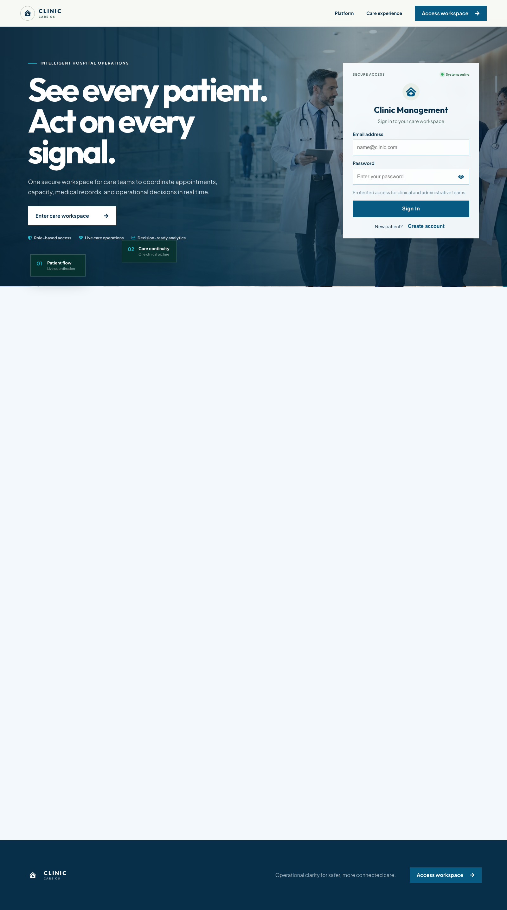
  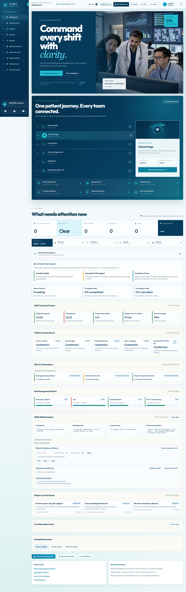
</p>
<p align="center">
  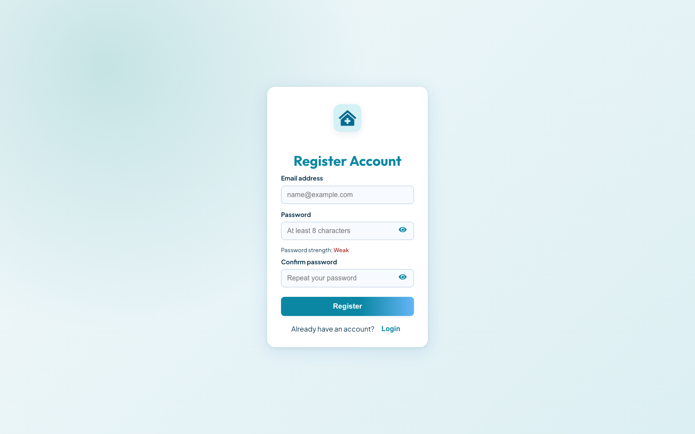
  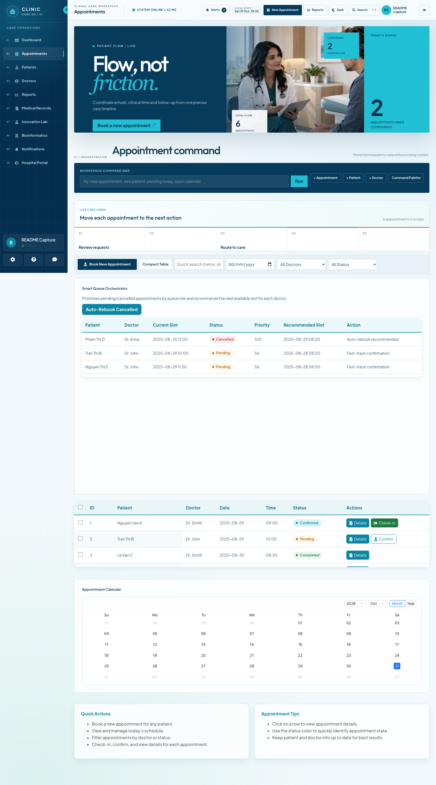
</p>
<p align="center">
  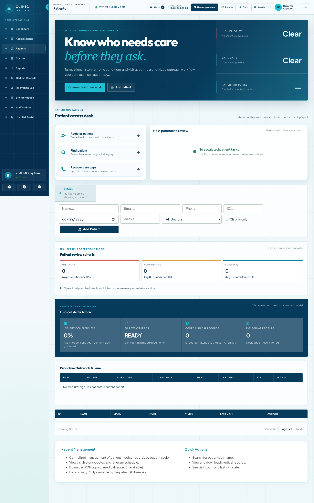
  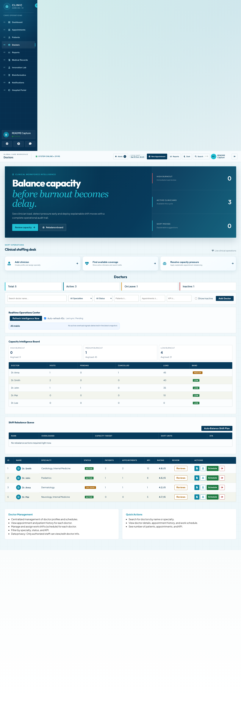
</p>
<p align="center">
  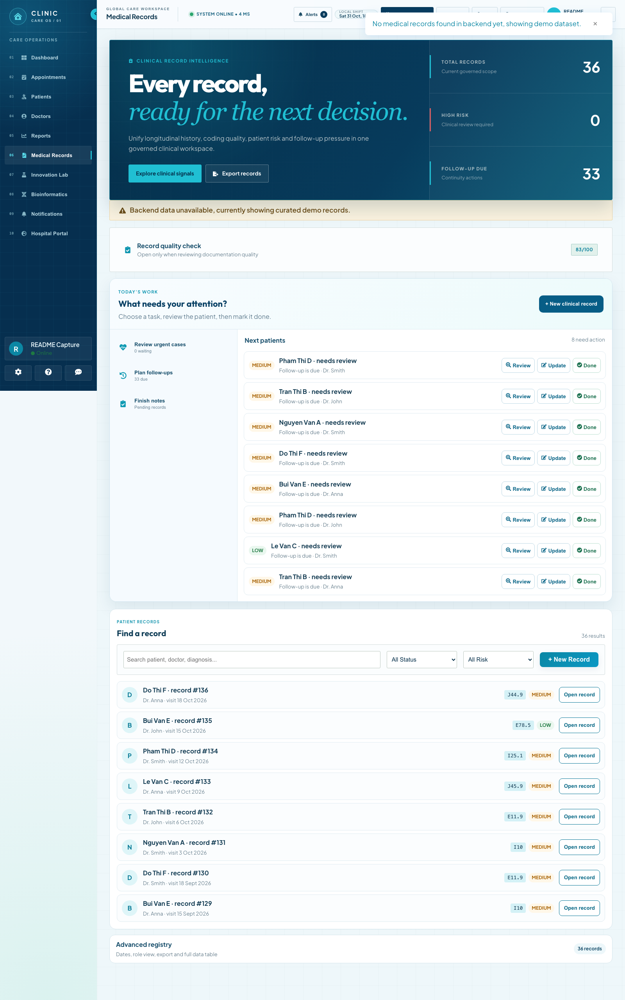
  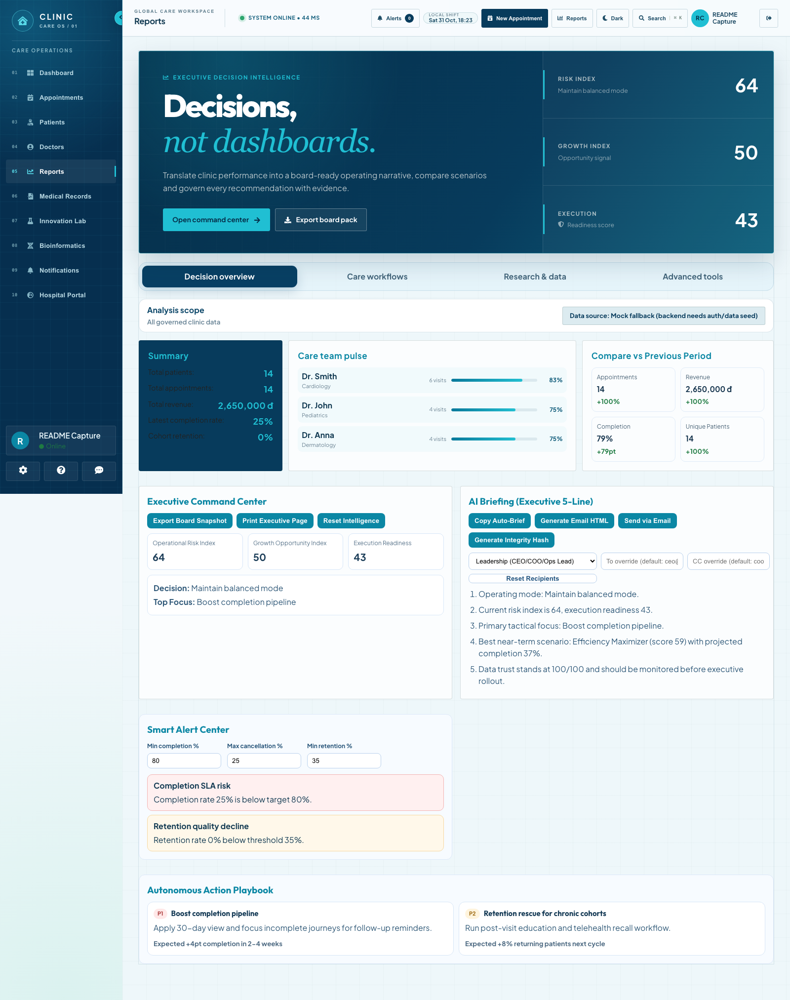
</p>
<p align="center">
  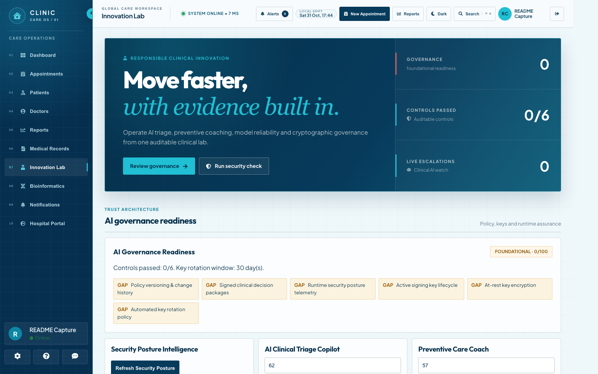
  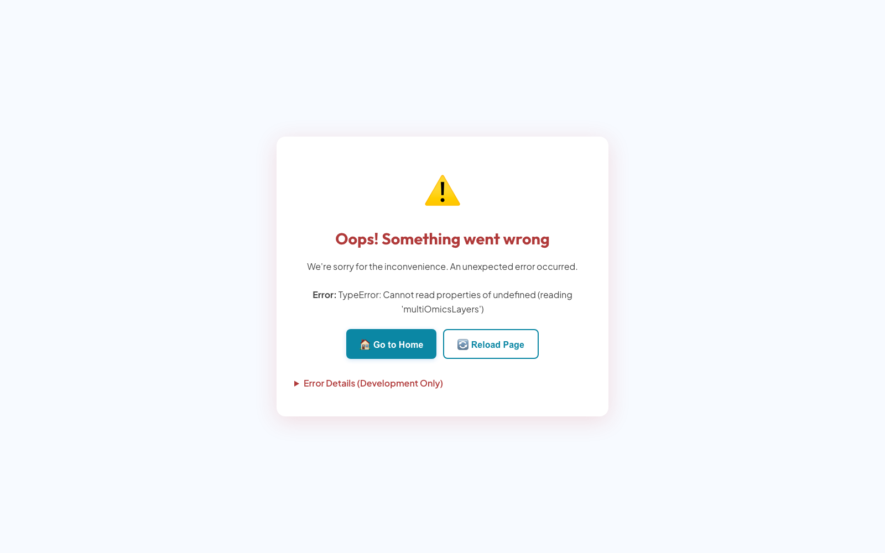
</p>
<p align="center">
  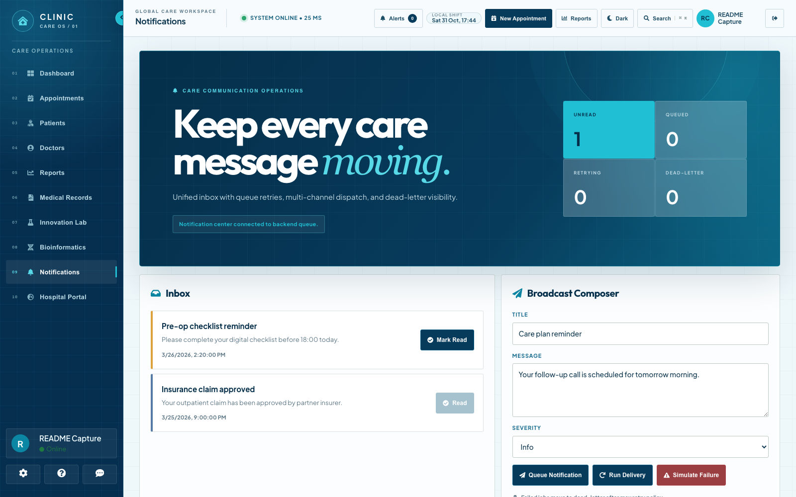
  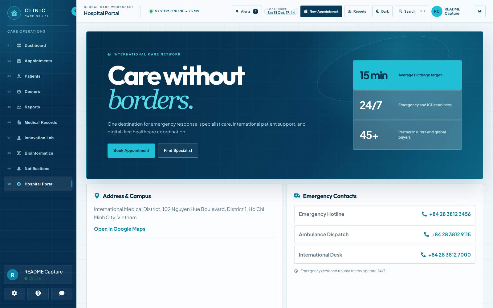
</p>
<p align="center">
  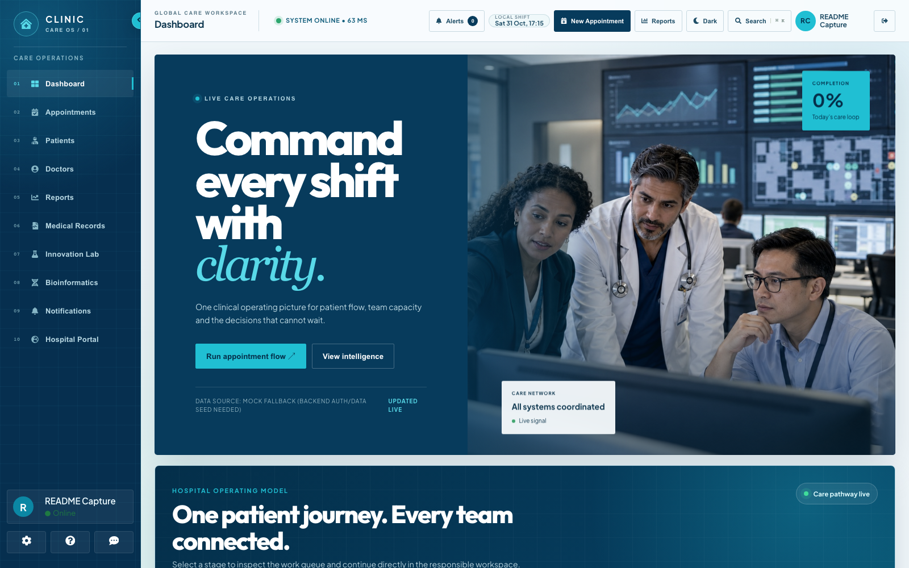
</p>

## Architecture

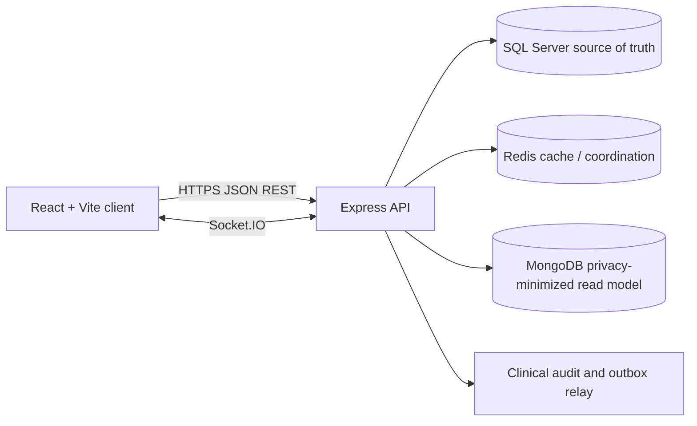

| Layer | Implementation |
| --- | --- |
| Frontend | React 19, Vite 7, React Router, Ant Design, tokenized CSS, Recharts |
| API | Node.js 20+, Express 4, JWT/MFA, validation, rate limits, Socket.IO |
| Relational data | SQL Server migrations, constraints, temporal history, row-version concurrency |
| NoSQL | MongoDB read models for privacy-minimized clinical events |
| Operations | Docker Compose, health/readiness probes, backup verification, GitHub Actions |
| Testing | Vitest, Playwright E2E, API smoke tests, k6 load-test scaffolds |

## Database and health-data principles

- SQL Server is the source of truth for transactional clinical workflows.
- Migrations are ordered and checksum-tracked in `backend/migrations/`.
- Synthetic records are clearly marked and isolated from production data paths.
- Row-version concurrency returns `409 Conflict` instead of silently overwriting updates.
- Audit/outbox workflows minimize sensitive data in NoSQL projections.
- Backup uses `COPY_ONLY`, checksums and `RESTORE VERIFYONLY`; see [database operations runbook](docs/DATABASE_OPERATIONS_RUNBOOK.md).

## Security and production hardening

- JWT access/refresh separation with MFA support.
- Production startup rejects weak/reused secrets and wildcard CORS.
- HTTPS CORS and encrypted database links are required in production.
- Security headers, request sanitization, response sanitization and origin checks.
- Payload size limits, route-specific rate limits and IPv6-safe limiter keys.
- Liveness/readiness endpoints: `/api/health/live`, `/api/health`, `/api/health/ready`.
- Graceful shutdown closes HTTP, SQL, Mongo and background workers.

This repository is production-engineered but not automatically certified for real-world clinical deployment. A real deployment still requires independent penetration testing, privacy/compliance review, clinical safety review, backup restore drills, monitoring/SIEM and incident-response procedures.

## Local setup

```bash
git clone https://github.com/TheHien04/Clinic-Management.git
cd Clinic-Management
npm install
npm --prefix frontend install
npm --prefix backend install
```

For the local Docker stack:

```bash
cp .env.docker.example .env
docker compose up -d
```

The local development URLs are:

| Service | URL |
| --- | --- |
| Frontend | http://localhost:5173 |
| API | http://localhost:5055 |
| Liveness | http://localhost:5055/api/health/live |
| Readiness | http://localhost:5055/api/health/ready |

## Quality gates

```bash
npm run qa:release
npm run qa:e2e
npm run qa:security
```

The release gate runs frontend lint/tests/build, backend unit tests and API smoke tests. E2E runs the critical login, notifications, patient portal and hospital portal flows.

## Documentation

- [Backend API guide](docs/BACKEND_API_GUIDE.md)
- [Health-data architecture](docs/HEALTH_DATA_ARCHITECTURE.md)
- [Database operations runbook](docs/DATABASE_OPERATIONS_RUNBOOK.md)
- [Testing, performance and security](docs/TESTING_PERFORMANCE_SECURITY.md)
- [Security guide](docs/SECURITY_GUIDE.md)
- [Architecture overview](docs/CODEBASE_ARCHITECTURE.md)
- [Contributing](CONTRIBUTING.md)
- [Security policy](SECURITY.md)

## License

MIT. See [LICENSE](LICENSE).
