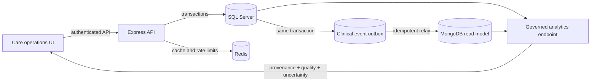

# Health data architecture

The runnable synthetic dataset and its exact row counts are documented in [SYNTHETIC_CLINICAL_DATASET.md](./SYNTHETIC_CLINICAL_DATASET.md).

## Decision summary

The application uses a polyglot persistence model with explicit ownership:

- **SQL Server is the transactional source of truth** for patients, appointments, doctors, and medical records.
- **Redis is an ephemeral acceleration layer** for response caching, rate limiting, and operational state. It never owns clinical facts.
- **MongoDB is an eventually consistent clinical event read model** for privacy-minimized, FHIR-inspired documents used by interoperability and analytics workloads.
- **The frontend consumes governed aggregates from the backend**. Clinical scoring logic is not treated as a browser-owned source of truth.

## Data flow

If MongoDB is unavailable, SQL writes continue and the health endpoint exposes the degraded read-model status. The relay retries with exponential backoff and idempotent Mongo upserts. Events that exceed the retry policy remain queryable as failed outbox rows for operational recovery.

## Analytics contract

`GET /api/patients/intelligence/overview` returns:

- six-month patient registrations based on `Patients.CreatedDate`;
- mutually exclusive operational review cohorts;
- row-level factor contributions and confidence based on available fields;
- identity and clinical-history completeness;
- SQL, FHIR-inspired document, and molecular-profile readiness.

The ruleset is explicitly **non-diagnostic**. It prioritizes manual care-team review using care gaps, cancellations, continuity gaps, and contactability. It must not automate treatment, diagnosis, eligibility, or denial of care.

## NoSQL and FHIR boundary

The `clinical_events` collection stores a narrow FHIR R4-inspired `Condition` envelope with ICD-10 coding when present. Free-text notes and prescriptions are intentionally excluded to reduce duplicated sensitive data. Indexes support event identity, longitudinal patient lookup, and resource-type timelines.

This is an interoperability-oriented read model, not a claim of full FHIR conformance. Full conformance would require profile validation, terminology services, consent/provenance resources, versioning, and conformance tests against an implementation guide.

## Bioinformatics boundary

The `molecular_profiles` collection is a governed extension point for future omics data. The UI reports whether profiles exist and never infers variants, diagnoses, ancestry, or treatment recommendations from routine records. A production genomics pipeline should use consent-scoped ingestion, immutable source files, genome-build and assay metadata, normalized HGVS/VCF representations, access auditing, and clinically validated interpretation workflows.

## Implemented governance foundation

- transactional clinical outbox and idempotent MongoDB relay;
- clinic identifiers in access tokens and scoped patient, appointment, and medical-record queries;
- append-only consent decisions;
- hash-chained, immutable clinical access audit events;
- governed ICD-10 terminology registry and coverage metric;
- consent-linked molecular metadata registry;
- persistent Compose volumes for SQL Server and MongoDB.
- system-versioned temporal history for patient master-data changes;
- `ROWVERSION` optimistic-concurrency token on patient records;
- procedure-backed, tenant-scoped patient directory with deterministic pagination;
- executable integrity checks for orphan rows, terminology, consent JSON, and outbox health;
- governed status constraints and covering/filtered indexes matched to live query patterns.
- required tenant-key constraints plus composite patient/doctor-to-appointment foreign keys that reject cross-clinic relationships at the SQL layer.

## Advanced database evidence

Migration `008_advanced_database_capstone.sql` is the executable source of truth for the capstone database controls. It creates:

- `dbo.vw_PatientCareSummary`, a reusable longitudinal aggregate;
- `dbo.sp_GetPatientDirectory`, a bounded server-side pagination procedure returning `TotalRows`;
- `dbo.sp_VerifyClinicalDataIntegrity`, a repeatable database health and referential-integrity check;
- temporal `dbo.PatientsHistory` records managed automatically by SQL Server;
- a row-version token for lost-update protection and targeted indexes for directory, visit, and relay workloads.

Run `Data/verify_health_data_integrity.sql` in SSMS or `sqlcmd` to produce report-ready evidence, including migration checksums and `STATISTICS IO/TIME` output.

## Remaining production hardening

1. Encrypt sensitive fields and backups with managed keys; rotate secrets outside Compose files.
2. Enforce tenant isolation with database row-level security in addition to API predicates.
3. Validate FHIR resources against a selected implementation guide through a dedicated terminology/interoperability service.
4. Monitor drift, subgroup error, calibration, and override outcomes before any statistical model replaces the transparent ruleset.
5. Define retention, deletion, consent, breach response, and data-residency controls for the target jurisdiction.
6. Obtain security, privacy, clinical-safety, and regulatory review before production use.

